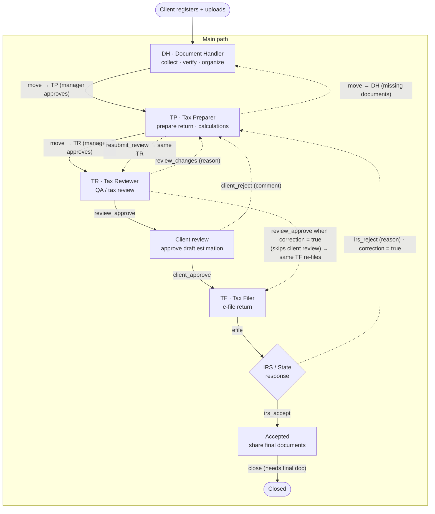

# Elite B Tax — Tax Workflow

The workflow is a **state machine stored in the database**:

* `public.profiles.stage` — where each client is now
* `public.workflow_transitions` — every allowed decision (from stage → to stage, who may do it)
* `public.wf_transition(client, action, actor, note)` — the only way a decision is applied;
  it checks role, holder, stage and required documents, moves the client, and writes the audit row
* `public.client_handoffs` — full history (hand-offs + decisions, `status = 'auto'` for decisions)
* `preparer_email / reviewer_email / filer_email` — remembered per client so every loop returns to
  **the same person** who worked that stage

## Diagram

## Stages

| Stage | Held by | Meaning |
|---|---|---|
| `unassigned` | — | New client, Admin assigns a DH |
| `documents` | DH | Collect / verify / organize documents (doc status pending → partial → received) |
| `preparation` | TP | Prepare the return (also every rework: `rework_source` = review / client / irs) |
| `review` | TR | QA / tax review |
| `client_review` | TR (watching) | Draft shared, waiting for the client |
| `filing` | TF | Ready to e-file (auto-assigned: remembered TF, else least-busy active Tax Filer) |
| `irs_pending` | TF | E-filed, waiting for IRS / State |
| `accepted` | TF | Accepted — upload final documents |
| `closed` | last holder | Done |

## Transitions

| Action | From → To | Who | Path | Rule |
|---|---|---|---|---|
| move to TP | documents → preparation | DH | happy | Manager approves; doc status must be "received" |
| move to TR | preparation → review | TP | happy | Manager approves |
| move to DH | preparation → documents | TP | rework | Manager approves (missing documents) |
| `review_approve` | review → client_review | TR | happy | A draft must be shared with the client |
| `review_approve` | review → filing | TR | rework | When `correction = true` (IRS rejection) — skips client review |
| `review_changes` | review → preparation | TR | rework | Reason required · back to the same TP |
| `resubmit_review` | preparation → review | TP | rework | Only during rework · back to the same TR, no approval needed |
| `client_approve` | client_review → filing | Client | happy | From the client dashboard (approve draft) |
| `client_reject` | client_review → preparation | Client | rework | Comment required · back to the same TP |
| `efile` | filing → irs_pending | TF | happy | `filing_cycle + 1` |
| `irs_accept` | irs_pending → accepted | TF | happy | Clears `correction` |
| `irs_reject` | irs_pending → preparation | TF | rework | Reason required · sets `correction = true` |
| `close` | accepted → closed | TF | happy | At least one final document must be shared |

Admins can perform any action on any client and can reassign anyone at any time from **Move to**.
